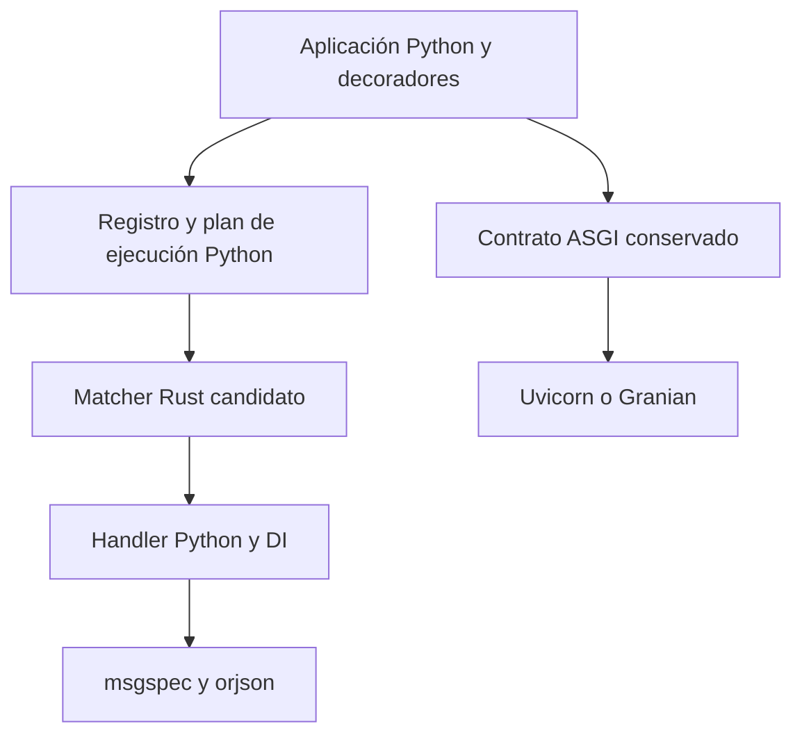

# Evaluación del framework — 2026-11-04

> The assessment below describes the 1.4.0 snapshot. The implementation brief at
> the end tracks the authorized 1.4.1 preparation; neither is a publication receipt.

Evaluación de `origin/main` en `ce995d7a75434782c3f59303026f15aa523a8e4f`,
Tachyon 1.4.0. No modifica el motor ni demuestra ausencia de defectos. Las pruebas
y mediciones son locales, en macOS ARM64 / CPython 3.13.18.

## Estado del producto

La base funcional tiene evidencia sólida dentro del alcance probado: 838 tests
pasaron en Python y Cython, tanto con las dependencias del entorno anterior como
con Starlette 1.10.0 y orjson 3.13.0. Son cuatro ejecuciones, no 3.352 contratos
distintos. La publicación original también comprobó CPython 3.10–3.13 y paquetes
instalados fuera del checkout; consultar [la evidencia de release](../audits/1.4.0/LOCAL_RELEASE.md).

Todavía no recomendaría la configuración bloqueada actual para producción sin
corregir su dependencia vulnerable. `poetry.lock` fija orjson 3.11.1 y
`pyproject.toml` permite instalarla. El [aviso GHSA-hx9q-6w63-j58v](https://github.com/advisories/GHSA-hx9q-6w63-j58v)
describe un problema de recursión profunda en `dumps`; la versión corregida indicada
es 3.11.6. El scanner devolvió dos registros del mismo aviso: se contabiliza **una
vulnerabilidad única**, no dos. No se construyó un exploit contra Tachyon.

Un entorno actualizado con orjson 3.13.0 pasó ambos motores y el scanner no encontró
avisos conocidos en sus 18 paquetes de runtime. Esto respalda actualizar el mínimo
y el lock; no constituye una auditoría completa de seguridad. Una instalación
nueva puede seleccionar una versión corregida porque el rango actual lo permite,
pero la metadata publicada tampoco la exige.

Para una recomendación más amplia faltan ejecuciones reales en Linux/Windows,
cargas prolongadas y validación del despliegue objetivo. Los soaks históricos de
60 segundos no acreditan estabilidad durante días. Los adaptadores Redis/Memcached
tienen contratos con dobles de prueba; esta evaluación no probó servicios reales.
La política de avisos de seguridad y versiones soportadas tampoco tiene un
`SECURITY.md`. No se afirma conformidad ISO ni un SLA.

## Limpieza y documentación

Inventario inicial: 333 archivos versionados; 32 Markdown, cuatro en la raíz.
El paquete contiene 103 archivos Python / 7.236 líneas, 25 Cython / 1.507 líneas
y nueve declaraciones `.pxd` / 73 líneas. Las líneas incluyen comentarios y
blancos; no miden complejidad por sí solas. El CLI ocupa 16 archivos / 2.093 líneas.

`docs/audits` contiene 56 archivos, aproximadamente 480 KB, contando evidencia
JSON y scripts. La documentación pública tiene un índice y 17 guías. El principal
problema observado es la convivencia de decisiones vigentes, narraciones de
reparación y snapshots históricos con estados diferentes. Por ejemplo,
`CONTINUOUS_IMPROVEMENT.md` conserva «unreleased» bajo un aviso histórico, mientras
`LOCAL_RELEASE.md` registra la publicación. Es historia señalizada, pero genera
ruido de lectura y búsqueda.

Propuesta de reorganización, pendiente de implementar:

1. Mantener README, CHANGELOG, LICENSE y una única guía de contribución/agentes
   como entradas de raíz. Archivar el drift report de raíz.
2. Conservar las guías públicas bajo `docs/`, con un índice único.
3. Mantener procesos vigentes bajo `docs/quality/`; este documento concentra la
   evaluación y las decisiones pendientes, sin crear otro informe en la raíz.
4. Consolidar las narraciones históricas de 1.4.0 en un resumen por release y
   trasladar su evidencia a un archivo claramente separado. Preservar hashes y
   trazabilidad; no borrar evidencia necesaria para reproducir la publicación.
5. Actualizar enlaces y scripts al mover archivos. Las URLs del tag `v1.4.0`
   siguen siendo referencias históricas inmutables utilizadas por la landing.

No se ha demostrado código muerto adicional en el runtime: un archivo pequeño o
un nombre privado no basta para declararlo eliminable. Los candidatos concretos
para reducir mantenimiento son las implementaciones paralelas, la compilación de
código de registro y la superficie de herramientas opcionales.

## Dependencias y diseño

- Cython compila los 25 `.pyx` indiscriminadamente. Parte del código, como el
  compilador de endpoints, trabaja durante el registro; su compilación necesita
  una justificación distinta de la velocidad por request.
- Uvicorn, httptools y Typer son dependencias obligatorias. Un núcleo ASGI con
  extras de servidor y CLI es una opción concreta para reducir instalación y
  dependencias transitivas. Requiere definir la compatibilidad del comando
  `tachyon` y errores de instalación; no basta con quitar líneas del TOML.
- Hay dos serializers: msgspec valida cuerpos/modelos y orjson atiende otras
  respuestas. Unificar podría eliminar una dependencia, pero `encode_json`
  expone opciones de orjson y existen diferencias de formatos/tipos. Se necesita
  una matriz de compatibilidad antes de sustituirlo.
- El backend usa setuptools y lee metadata de Poetry. La metadata tiene una
  fuente, pero se mantienen dos herramientas de build. Simplificarlo sería una
  tarea separada de cambiar el motor.
- El extra de benchmark restringe FastAPI a `^0.136.1`; el competidor actual
  0.162.0 se instaló explícitamente en un entorno aislado para esta evaluación.
  Conviene parametrizar las versiones del ensayo, conservando sus resoluciones.
- La validación de respuestas hace encode → decode tipado → encode. Ese costo
  protege contratos reales: no debe eliminarse sin conservar las regresiones de
  modelos mutados, valores anidados y números no finitos.

## Python, Cython y Rust

No hay `.rs`, `Cargo.toml`, PyO3 ni un motor Rust propio en el repositorio.
orjson es una dependencia implementada en Rust; Ruff es una herramienta de
desarrollo Rust. No los mantiene este proyecto. Usar una biblioteca nativa no
obliga a mantener ese lenguaje en el framework.

| Alternativa | Mantenimiento | Evaluación |
| --- | --- | --- |
| Python como única implementación propia | Menor; una lógica y wheel portable | Primera opción a evaluar con presupuestos por escenario |
| Python + Cython desde una fuente `.py` | Se mantienen builds nativos, pero se puede evitar duplicar lógica | Alternativa si un perfil demuestra que la aceleración merece su costo |
| Python + Rust propio | Nueva frontera de integración y una reescritura que validar | No justificado por la evidencia actual |

[Cython admite pure Python mode y declaraciones auxiliares](https://github.com/cython/cython/blob/master/docs/src/tutorial/pure.rst).
No implica que estos 25 módulos puedan migrarse automáticamente: hay clases
tipadas, `cimport`, declaraciones y semántica Python que deben comprobarse.

Eliminar `.pyx`/`.pxd` retiraría 34 archivos y 1.580 líneas de fuentes auxiliares,
además del trabajo de paridad y publicación nativa. El wheel portable publicado
ocupa 110.755 bytes y el CPython 3.13 nativo 1.030.467 bytes, aproximadamente 9,3
veces más. Son tamaños de archivo comprimido, no memoria residente; ambos todavía
dependen de bibliotecas nativas de terceros.

Recomendación: favorecer una implementación Python única; conservar aceleración
propia solamente donde una medición aislada y del despliegue objetivo demuestre
beneficio suficiente. No introducir Rust para resolver duplicación de código.
Un posible presupuesto de aceptación para la simplificación debe acordarse por
escenario y p95/p99, no imponerse como porcentaje universal o norma ISO.

## Mediciones y límites

Se conservan dos comparaciones: el entorno anterior con FastAPI 0.136.3 y un
entorno actualizado con FastAPI 0.162.0. En cada una se midieron Tachyon Python,
Tachyon Cython y las referencias FastAPI/ASGI de cada bloque. Cada bloque tiene
cinco repeticiones, ocho escenarios, 2.000 requests medidas por escenario y 100
warmups, con concurrencia ocho: 240.000 respuestas medidas.

Un worker Uvicorn 0.35.0, asyncio/h11, sin access logs ni lifespan. Endpoints
async, mismos inputs, outputs exactos y scope de dependencia. Cada respuesta
comprueba status, tipo de contenido y JSON. Se registran latencias individuales,
errores, versiones, revisión y origen real del trie. La referencia ASGI no valida
como los frameworks: sirve para observar el límite del ensayo, no como competidor
equivalente.

Cliente Python y servidor comparten host; no se aisló CPU ni se controló potencia
o temperatura. Los motores corrieron en bloques sucesivos, no intercalados. El
orden se invirtió entre entornos, pero no elimina el sesgo. Las tasas incluyen
costos del cliente y pueden acercarse al límite del generador. Un delta pequeño
entre motores no prueba beneficio de Cython ni equivalencia.

La comparación cubre ocho rutas y entradas válidas pequeñas, no escalado con
miles de rutas, cargas sync, errores, streaming, WebSockets ni bases de datos
reales. No estima capacidad de producción, RAM o un multiplicador general.
Los percentiles resumidos son medianas de percentiles por repetición; no un p99
global combinado. Nunca se suman las tasas de escenarios diferentes.

Medianas de throughput del entorno actualizado (requests correctas por segundo):

| Escenario | Tachyon Python | FastAPI, bloque Python | Tachyon Cython | FastAPI, bloque Cython |
| --- | ---: | ---: | ---: | ---: |
| hello | 12,771 | 8,946 | 12,364 | 8,676 |
| path_query | 11,595 | 7,119 | 11,639 | 6,990 |
| body | 9,784 | 7,274 | 9,582 | 7,070 |
| nested_body | 9,615 | 7,155 | 9,654 | 7,088 |
| response_model | 12,266 | 8,358 | 12,138 | 8,336 |
| header | 12,113 | 8,049 | 12,000 | 7,965 |
| dependency | 11,000 | 7,577 | 10,739 | 7,495 |
| query | 11,357 | 6,814 | 11,475 | 6,757 |

En el bloque Python, las razones de medianas Tachyon/FastAPI van de 1,34 a
1,67 según escenario. No es una razón global ni una comparación pareada de cada
request. Cython frente a Python varía de −3,2% a +1,0% de throughput entre bloques:
esta prueba no demuestra una ventaja consistente del motor compilado. También
cambia la referencia ASGI; no es válido atribuir esos deltas solamente al motor.

Las cuatro corridas retienen 960.000 respuestas medidas correctas, cero errores:
480.000 del entorno actualizado y 480.000 del anterior. Ambos entornos usan
msgspec 0.19.0, Uvicorn 0.35.0 y Pydantic 2.14.2. El anterior usa Starlette 1.3.1,
orjson 3.11.1 y FastAPI 0.136.3; el actualizado usa Starlette 1.10.0, orjson 3.13.0
y FastAPI 0.162.0. Las cifras de entornos diferentes no aíslan el efecto de
actualizar FastAPI ni de ninguna dependencia individual.

[Resumen, rangos por repetición, p95/p99 y hashes](evidence/2026-11-04/summary.json).
[Datos completos comprimidos](../../benchmark/results/2026-11-04/), reproducibles
con el runner existente y las configuraciones/versiones registradas. El campo
`git_dirty` de las mediciones es falso; las fuentes del producto son las de la
revisión citada. Los informes de tests retienen sus fingerprints y orígenes de
los 25 módulos para comprobar el motor realmente importado.

## Orden de trabajo propuesto

1. Corregir mínimo/lock de orjson, validar paquetes instalados y preparar 1.4.1.
2. Reorganizar documentación y evidencia con enlaces y contratos verificados.
3. Medir overhead del motor y rutas a mayor escala, además de HTTP completo;
   fijar presupuestos de regresión antes de retirar Cython.
4. Ejecutar la simplificación elegida preservando la API y los tests; separar
   CLI/servidor como extras si su costo de compatibilidad lo permite.
5. Validar Linux y una carga prolongada en el entorno de despliegue; documentar
   soporte y avisos de seguridad antes de ampliar la recomendación de producción.

## Investigación ampliada: retirar Cython y evaluar Rust

Consulta de fuentes oficiales y Context7 el 2026-11-04. Los experimentos siguientes
son descartables y no modifican las fuentes Python del producto ni se publican.
La conclusión sobre viabilidad de retirar Cython es experimental; la arquitectura
Rust propuesta todavía no está implementada ni medida.

### Acoplamiento real a Cython

| Capa | Acoplamiento observado | Consecuencia de retirarlo |
| --- | --- | --- |
| Imports de los 103 `.py` | Ninguno importa Cython | La lógica Python puede ejecutarse independientemente |
| Módulos acelerados | 25 pares: app 1, seguridad 1, procesamiento 5, extractores 10, DI 4, respuestas 3, routing 1 | Retirar las implementaciones alternativas; conservar nombres de módulos |
| Integración nativa interna | `parameters.pyx` importa ocho clases de extractores mediante `cimport`; nueve `.pxd` | Las declaraciones no son necesarias para Python |
| Build | `setup.py`, requisitos de build, extra `fast`, grupo dev, includes de sdist | Eliminar compilación y su dependencia aislada, preservando instalación compatible |
| Verificación | Paridad, descubrimiento de módulos, origen de imports y contratos de wheels | Adaptar controles para que no queden vacíos |
| Release y CI | Dos motores, cibuildwheel, rebuild nativo desde sdist y matriz por ABI | Sustituir gates nativos por wheel portable e instalación desde sdist |

En particular, `check_py_pyx_parity.py` falla al no encontrar `.pyx`, mientras
`quality_cycle.py` y `test_installed_wheel.py` construyen su inventario desde esos
archivos. Sus recorridos de verificación de origen quedarían vacíos. La migración
debe verificar un inventario Python no vacío y rechazar explícitamente un motor
nativo inexistente. Los tests funcionales actuales no sustituyen ese ajuste.

La prueba descartable retiró 34 fuentes auxiliares, desactivó el bloque de
compilación en setup y eliminó los requisitos Cython del TOML. Los 103 `.py`
permanecieron byte por byte idénticos. Se conservó `fast = []`: el wheel declara
el extra para que instalaciones existentes con `[fast]` sigan siendo válidas,
aunque deba documentarse su deprecación.

- CPython 3.13: 838 tests pasaron; wheel portable y sdist se construyeron en
  aislamiento sin requisito Cython. Wheel: 110.904 bytes; sdist: 145.441 bytes.
- Instalación limpia: 174 contratos pasaron fuera del checkout. Se verificaron
  adicionalmente los 103 orígenes Python; Cython no estaba instalado y el paquete
  no contenía `.so/.pyd`. Esta comprobación adicional evita confiar en el
  inventario `.pyx` vacío del script original.
- En la misma copia sin Cython, CPython 3.10, 3.11 y 3.12 también pasaron
  838 tests cada uno; esos entornos conservaban herramientas de build instaladas.
  La instalación limpia sin Cython se verificó en 3.13. Resultados y logs están en la
  [evidencia de retirada](evidence/2026-11-04/cython-removal.json).

Esto demuestra factibilidad del runtime y empaquetado portable, no una migración
terminada. Aún se deben adaptar scripts, workflows, lockfile, documentación y
política de compatibilidad. Las instalaciones editables o builds manuales pueden
conservar `.so` anteriores que toman prioridad sobre `.py`; una bandera de build
no los desactiva. Hay que probar también la actualización desde un wheel nativo
existente y reiniciar procesos de servicio.

### Qué dependencias conviene conservar o evaluar

| Pieza actual | Uso en Tachyon | Opción Rust y evaluación |
| --- | --- | --- |
| orjson | `models.py`, serialización sin response model | Ya es Rust; actualizar versión segura, sin reescritura propia |
| msgspec | Struct público, Decoder, validación, campos y JSON Schema | Conservar inicialmente: sustituirlo requiere un contrato nuevo, no un cambio de import |
| Uvicorn + httptools | CLI/servidor, no dependencia conceptual de ASGI | Granian como opción de despliegue; medir también Uvicorn con parser acelerado |
| Starlette | Imports en 34 `.py`: Request/Response, uploads, WebSockets, lifespan, middleware, threadpool y testing | Mantener: reemplazarlo exige implementar muchos protocolos y contratos |
| python-multipart | Parsing a través de Starlette y Request gestionado | No hay sustitución directa acreditada en esta investigación; preservar límites y cleanup |
| Typer | Diez módulos Python del CLI | Su costo pertenece a herramientas; separarlo del núcleo puede aportar más que traducirlo a Rust |

El conteo es de imports AST directos, no de costos medidos. `msgspec` 0.19.0 tiene
un [núcleo C](https://github.com/msgspec/msgspec/blob/0.19.0/msgspec/_core.c);
orjson documenta su [build Rust](https://github.com/ijl/orjson#packaging).
Que una dependencia esté en C no la convierte en un cuello de botella.

`pydantic-core` es una alternativa Rust de validación, pero su
[README oficial](https://github.com/pydantic/pydantic/blob/main/pydantic-core/README.md)
recomienda consumirlo a través de Pydantic. Integrarlo directamente nos haría
responsables de traducir anotaciones, schemas, errores, coerción y construcción
de modelos. Cambiar `Struct` por `BaseModel` tampoco conserva la API. Los benchmarks
del autor de msgspec son [históricos y advierten sobre sus límites](https://msgspec.dev/benchmarks);
no justifican una comparación actual sin medir nuestras cargas.

En el entorno local, los archivos registrados de msgspec 0.19.0 ocupan 455.968
bytes, y pydantic-core 2.50.2, 4.830.835. No incluyen dependencias transitivas ni
archivos no registrados; no son medidas de RSS. Reemplazar msgspec por el core
Rust medido no produciría automáticamente una instalación menor.

### Granian medido, incluyendo Uvicorn con httptools

[Granian](https://github.com/emmett-framework/granian) ofrece ASGI y puede alojar
Tachyon sin trasladar sus endpoints a Rust. Se midió 2.8.7 contra Uvicorn 0.35.0,
con el mismo Tachyon Python y las mismas versiones actualizadas de dependencias.
Se incluyeron FastAPI y ASGI como controles, no solamente Tachyon.

Tres repeticiones × tres servidores × tres aplicaciones × ocho escenarios ×
2.000 requests = 432.000 respuestas medidas, todas correctas. Orden de servidor y
aplicación permutado por repetición, concurrencia ocho, 100 warmups por escenario,
un worker, asyncio, HTTP/1 y sin lifespan/access logs. Granian usó `asginl`,
un runtime thread y su configuración restante por defecto; no RSGI ni un loop Rust.
Los parsers son h11, httptools y el stack HTTP de Granian respectivamente.
La prueba evalúa stacks concretos: no aísla el lenguaje de implementación.

Medianas de throughput de Tachyon Python, requests correctas por segundo:

| Escenario | Uvicorn h11 | Uvicorn httptools | Granian |
| --- | ---: | ---: | ---: |
| hello | 10,961 | 13,468 | 15,640 |
| path_query | 10,451 | 13,128 | 14,412 |
| body | 8,818 | 10,792 | 10,052 |
| nested_body | 8,088 | 11,315 | 11,563 |
| response_model | 9,576 | 13,390 | 15,577 |
| header | 11,776 | 12,812 | 14,648 |
| dependency | 10,823 | 13,788 | 13,074 |
| query | 9,326 | 13,019 | 13,950 |

Granian no ganó en todos los escenarios frente a httptools. Tampoco se midió
Uvicorn con uvloop, por lo que no se compara contra su mejor configuración posible.
La referencia ASGI, las variaciones por repetición y el cliente en el mismo host
impiden atribuir cada delta al servidor. WebSockets, streaming, lifespan real,
TLS, apagado y presión sostenida con Granian requieren contratos adicionales.

Archivos instalados registrados: Granian 16.725.741 bytes; Uvicorn 217.895 y
httptools 385.023, excluyendo transitivas en ambos casos. Una alternativa puede
ser útil por throughput o comportamiento operativo aunque su binario sea mayor.
Los [tamaños y su método](evidence/2026-11-04/rust-dependency-sizes.json) y los
[resultados por escenario](evidence/2026-11-04/rust-research.json) quedan separados
de las promesas del producto.

Se descartó recomendar [rloop](https://github.com/gi0baro/rloop) para producción:
su propio README todavía lo desaconseja. Robyn es otro framework con una API
propia; su [discusión de compatibilidad ASGI](https://github.com/sparckles/Robyn/issues/1193)
no acredita que pueda reemplazar Starlette o Uvicorn en este proyecto. No fue
probado como backend. Hyper, Tokio y Serde son piezas Rust, no sustitutos de
Request/Response y del lifecycle Python por sí mismas.

### Frontera propuesta para un futuro núcleo Rust

Mantener en Python el API de decoradores, introspección de firmas, registro,
configuración, lifetimes DI y callbacks del usuario. El primer candidato medible
es un matcher de rutas: entrada `path + method`, salida `status + route_id +
capturas + Allow`; un único cruce por match, con la tabla de rutas preparada en
registro. No hacer una llamada Rust por cada pequeño extractor.

El perfil debe demostrar que ese matcher merece aceleración a 10, 100, 1.000 y
10.000 rutas, incluyendo misses, 405 y rutas ambiguas. Preservar nombres de
parámetros por terminal, backtracking, Unicode y `root_path`. Después se podría
evaluar un plan completo de extracción; no migrar validación por anticipado.

[PyO3 documenta costos de conversión y acceso al intérprete](https://pyo3.rs/main/performance.html).
Convertir objetos Python en colecciones Rust y volver a crear objetos por cada
parámetro puede anular una mejora algorítmica. Los callbacks Python siguen
necesitando el intérprete; Rust no elimina su GIL. Liberarlo alrededor de matches
minúsculos tampoco es una optimización automática. Los números Python no deben
restringirse accidentalmente a `i64`, ni los errores perder su contrato.

Un futuro paquete `_tachyon_core` podría usar PyO3/maturin y evaluar
[abi3 para CPython 3.10+](https://pyo3.rs/main/building-and-distribution.html#py_limited_apiabi3abi3t).
Reduce variantes por versión en los builds compatibles, pero conserva wheels por
SO/arquitectura y limita ciertas optimizaciones. No elimina la matriz de pruebas,
el trabajo de seguridad ni la necesidad de toolchain al compilar desde fuentes.

El destino debería tener una sola implementación autoritativa por algoritmo:
orquestación Python y núcleo Rust delimitado. Si se mantiene un fallback Python
paralelo en producción indefinidamente, se recrea el costo de paridad actual.
La referencia Python puede servir durante la evaluación, con un plan explícito
para cerrar esa duplicación si Rust resulta elegido.

### Secuencia de versiones y condiciones de aceptación

1. **1.4.x:** resolver orjson vulnerable; retirar Cython conservando los módulos
   Python, comportamiento de instalación y extra `fast` transitorio. Rehacer
   gates de release y probar upgrade desde el paquete nativo. Publicar migración
   con resultados por plataforma y presupuestos de regresión.
2. **1.4.x, opt-in:** comprobar Granian con contratos reales ASGI y documentar su
   uso sin reemplazar silenciosamente el servidor que espera el usuario.
3. **Siguiente etapa experimental:** perfilar y prototipar solamente el matcher
   Rust. Comparar Python actual, Cython histórico y Rust con el mismo trabajo,
   tamaños, RSS, latencias y errores. Medir concurrencias y payloads distintos.
4. **Release con cambio de contrato, si corresponde:** adoptar Rust obligatorio,
   retirar defaults de CLI/servidor o cambiar modelos solamente con compatibilidad
   demostrada o una migración explícita. No meter esos cambios bajo una etiqueta
   patch por el solo hecho de que conservan nombres de decoradores.

Propuesta para decidir, no resultados existentes: pruebas de comportamiento en
3.10–3.13 y plataformas objetivo; validación de wheels/sdist y actualizaciones;
repeticiones suficientes para distinguir ruido; presupuesto de p95/p99 acordado;
tamaños de instalación y RSS separados; carga prolongada y revisión de crates.
Solo se adopta un núcleo nuevo si compensa el costo de mantenerlo y distribuirlo.

## Implementation brief: one Python engine before a Rust decision

- Author: Juan Manuel Panozzo Zenere
- Date: 2026-11-04
- Status: authorized implementation in progress; no Goldfish review claimed.

### Overview and boundaries

Prepare 1.4.1 by removing duplicate Cython implementations, excluding vulnerable
orjson releases, and preserving Python API and default installation behavior.
Keep one current decision record here instead of adding a root RFC. The owner
approved this staged direction after reviewing the research above.

### Alternatives and objections

Keeping all 25 compiled modules retains a second behavior matrix without a
consistent benefit in the measured small-route HTTP workloads. Rewriting all
layers in Rust would replace tested protocol/model behavior and increase release
work before proving a benefit. Retaining Starlette/msgspec and evaluating a
bounded Rust matcher later avoids that immediate rewrite. A Python-only release
could regress workloads not represented here, so profiling, upgrade tests and
explicit platform limits remain release gates.

### Decisions and staging

1. Preserve module paths, `[fast]` as an empty deprecated alias, and Uvicorn/CLI
   defaults. Do not remove mandatory server dependencies in a patch release.
2. Verify every Python module, fail on empty inventories or leftover native
   files, rebuild sdists, test installed artifacts and simulate native upgrades.
3. Retain historical evidence under the release archive; record new validation
   together and stop producing root audit reports.
4. Evaluate Granian through ASGI, with real lifecycle/WebSocket/streaming checks
   before recommending production. Keep server choice explicit.
5. Prototype Rust only after profiling route counts and request costs. The target
   is one authoritative implementation per algorithm, with Python configuration
   and callbacks around a bounded native core. No new Rust runtime is introduced
   by the 1.4.1 cleanup itself.

## 1.4.1 implementation result — 2026-11-04

Prepared locally, **not published**. The [validation summary](evidence/1.4.1/summary.json)
records 40 successful preparation gates: 856 full-suite tests on each of CPython
3.10–3.13, 103 Python origins checked per source run, 174 installed contracts per
candidate/rebuilt wheel on each interpreter, and six real-server contracts per
interpreter for Uvicorn/Granian. All ran on macOS ARM64; hosted workflows were not
executed. Package dependency versions and source fingerprints are retained.

The final 60-second source soak validated 505,193 requests with zero errors. An
earlier 120-second preparation validated 968,490 with zero errors; it preceded
final documentation/verification changes and is not the final artifact snapshot.
Neither run establishes multi-hour endurance or a capacity SLA.

Normal upgrades from the four original native 1.4.0 wheels to the final portable
candidate removed all 25 old extensions. `[fast]` stayed installable without Cython;
all 103 installed Python modules and installed contracts passed. The recorded
candidate hashes identify the actual upgrade artifact. The dependency scanner
found no known advisories in the 19 resolved runtime/optional-Granian packages.
This does not establish absence of vulnerabilities.

Final artifacts: portable wheel 110,501 bytes; sdist 149,108 bytes. Archive checks,
strict metadata checks and upload dry run passed. The retained Python runtime AST
is unchanged after excluding docstrings; runtime edits only remove obsolete
comments/docstrings. Existing HTTP/model behavior remains under the same contracts.

The benchmark CLI now records explicit Uvicorn parser or Granian selection. Both
paths verified 72,000 responses each with zero errors. These follow-up checks
overlapped upgrade validation and are kept as CLI correctness evidence, not new
performance comparisons. Use the controlled research measurements above for the
dated performance assessment and rerun on the deployment target before making claims.

The root drift report moved into the historical release archive. This document
contains both the research and staged implementation brief; no root RFC or new
runtime Rust implementation was added. A future Rust matcher remains subject to
profiling and the behavioral/distribution criteria in the brief.
